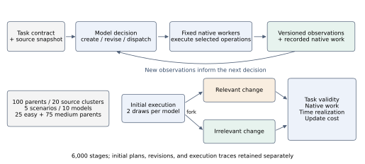

# WELD

**Work, Execution, and Lifecycle Diagnostics**
An executable benchmark for how language models build and adapt dynamic workflows.

[English paper](weld_release/paper/WELD_ACL_EN.pdf) · [中文论文](weld_release/paper/WELD_ACL_ZH.pdf) · [中文说明](README_zh.md) · [Reading guide](docs/weld/READING.md) · [Reproduction](docs/weld/REPRODUCING.md)

**WELD: How Well Do Language Models Build and Adapt Dynamic Workflows?**
Zhixuan Liu and Qi Yan · Northeastern University
Research manuscript, October 2026. Qi Yan is the corresponding author.

## What WELD measures

A correct answer can come from very different amounts of work. A smaller workload can yield a modest speedup. A completed result can remain correct after one change and require fresh evidence after another. WELD measures these relationships through model-created workflows, fixed native workers, executable validators, and versioned execution records.

The model chooses investigations, dispatches dependent operations, reads observations, and revises its workflow while it runs. WELD records the initial plan, revisions, actual execution, artifact provenance, and resource use separately.



Three questions organize the benchmark:

1. **Among valid solutions, which workflows do less work?** Compare vectors of domain-native work on the same task. Keep dominance, equality, and resource trade-offs distinct.
2. **How much of a workload reduction becomes an end-to-end benefit?** Compare work savings with observed time savings, separating online completion, request admission, and fixed-response native replay.
3. **How well does a completed workflow adapt?** Branch from the same checkpoint into relevant and irrelevant changes. Measure restored validity, preservation, new work, time, and reuse.

Task validity is reported over **every attempted stage**. It also determines eligibility for paired work and timing comparisons. WELD reports a measurement profile; it does not combine quality, work, time, and adaptation into a weighted total.

## Released experiment

| Item | Final study |
|---|---:|
| Scenarios | 5 |
| Parent tasks / source clusters | 100 / 20 |
| Easy / medium parents | 25 / 75 |
| Conditions | initial, relevant change, irrelevant change |
| Models / generation repeats | 10 / 2 |
| Logical stages | 6,000 |
| Fixed-response native executions | 8,874 |

Every scenario has 20 parents: five easy and fifteen medium. The scenarios cover graph investigation, code review and impact analysis, relational analytics, telemetry investigation, and application-state operations. See [dataset construction](docs/weld/DATASETS.md) for sources and transformations.

All ten models were served through APIs. Tables separate six open-weight model families from four closed-model APIs. Endpoint, route, and sampling records define each evaluated system; see [experiment configuration](docs/weld/EXPERIMENTS.md).

## Main observations

| Observation | Released evidence |
|---|---|
| Valid solutions induce different work | **2,241 of 5,006** valid initial pairs exhibit work dominance; 372 exhibit trade-offs. |
| Call counts hide native work | **187 pairs** have equal tool-call counts but unequal primary native work. |
| Work savings can be attenuated online | On medium tasks, the equal-parent mean work-saving minus time-saving gap is **31.6 percentage points**, or **14.5 points** after subtracting local admission waits. Native replay often realizes the savings. |
| Repair and preservation differ | From 1,479 valid initial results, **807 relevant** and **1,468 irrelevant** continuations remain valid: 54.6% and 99.3%. |

These quantities use different eligible populations. [Metrics](docs/weld/METRICS.md) defines every denominator, timing domain, and unit. Timing estimates average pairs within parents before averaging across parents.

## Start in one minute

Python 3.12 or newer is sufficient for the numerical reproduction. This command uses only the standard library and makes no API calls.

```bash
git clone https://github.com/zhixuanliu867-ship-it/WELD.git
cd WELD
python weld_release/scripts/reproduce_results.py
```

It verifies release hashes, the task matrix, validity counts, work relations, and adaptation denominators, then writes `weld_release/reproduced/summary.json`. [Reproduction instructions](docs/weld/REPRODUCING.md) cover figures, manuscript compilation, and full-archive replay.

## Repository map

| Path | Contents |
|---|---|
| `weld_release/paper/` | English/Chinese manuscripts, LaTeX, bibliography, ACL style |
| `weld_release/figures/` | Editable SVG, vector PDF, PNG previews |
| `weld_release/data/` | All 6,000 stage records, pair tables, timing and adaptation analyses |
| `weld_release/benchmark/` | Measured evaluator, domain adapters, public task cards, experiment scripts |
| `weld_release/provenance/` | Source receipts, code hashes, model profiles, acceptance evidence |
| `weld_release/scripts/` | Numerical reproduction and figure generation |
| `docs/weld/` | Reading, dataset, metric, experiment, and reproduction documentation |

Root-level `rcwg_*` packages, original specifications, and older documents preserve the early RCWG implementation. The current paper uses `weld_release/`; [history](docs/weld/HISTORY.md) explains the transition.

## Data access

This repository releases numerical tables, public task cards, evaluator source, figure scripts, and manuscripts. The full archive additionally contains raw model responses, physical attempts, frozen source assets, and evaluation labels. Those large artifacts are maintained separately and are **not downloaded by the quick-start command**. Full trace replay requires that archive. The public table reproduction is immediately runnable; [data availability](docs/weld/REPRODUCING.md#data-availability) states the exact coverage.

## Citation

```bibtex
@misc{liu2026weld,
  title  = {WELD: How Well Do Language Models Build and Adapt Dynamic Workflows?},
  author = {Liu, Zhixuan and Yan, Qi},
  year   = {2026},
  note   = {Research manuscript},
  url    = {https://github.com/zhixuanliu867-ship-it/WELD}
}
```

## License

Original WELD code uses the [MIT License](LICENSE). Upstream datasets, third-party code, and the ACL template retain their respective terms; see [notices](THIRD_PARTY_NOTICES.md). Report reproducibility issues through [GitHub Issues](https://github.com/zhixuanliu867-ship-it/WELD/issues), including the release commit and failing command.
